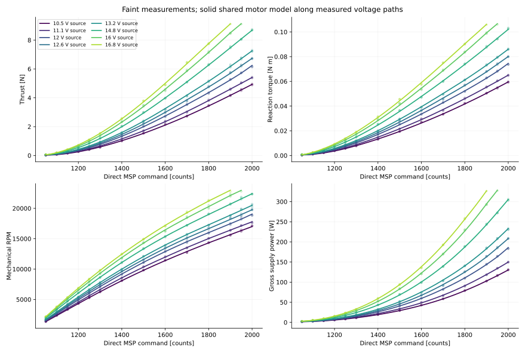
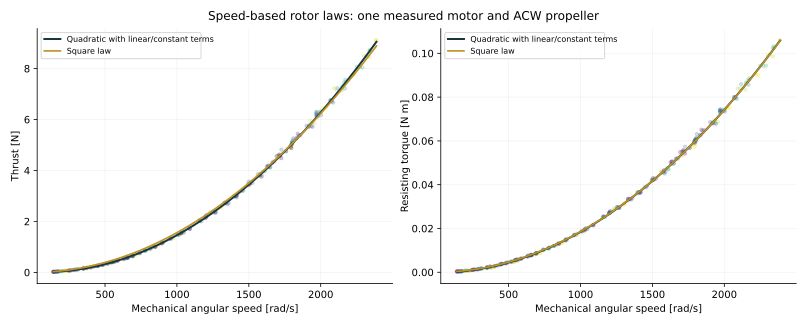
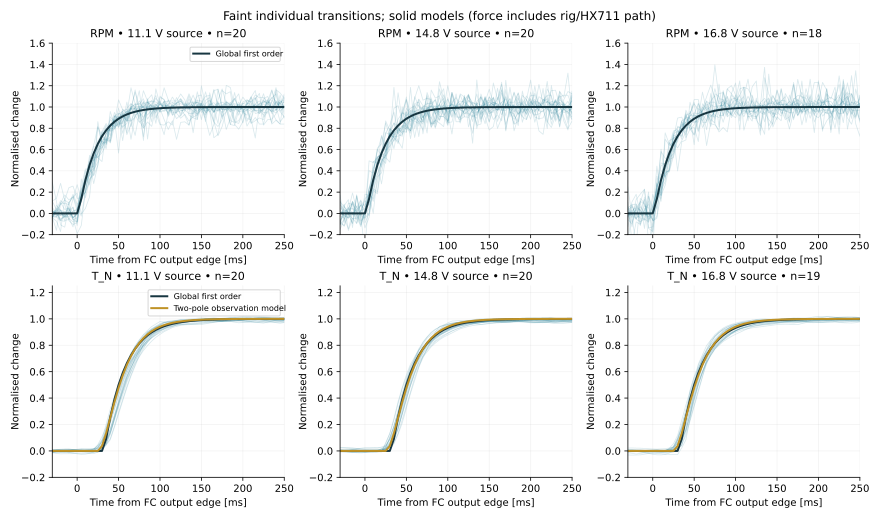
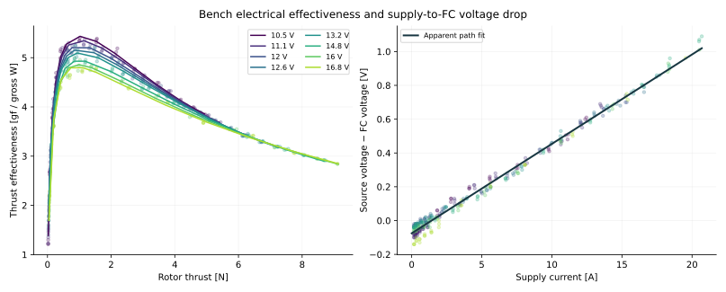
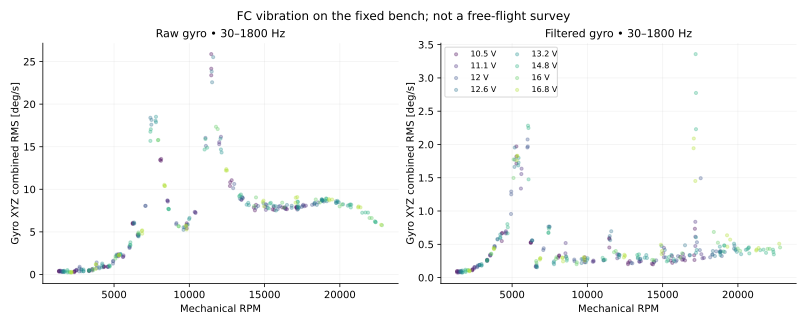

# Actuator modelling

[Runtime](../raven_actuator.py) · [Static parameters](../parameters/static_models.json) · [Dynamics](../parameters/dynamic_models.json) · [Recommendation](../parameters/recommendation.json)

One EMAX ECO II 2207 1900 KV motor with an HQ 5×4.8×3 V1S **ACW** propeller was tested on the existing thrust/torque rig. Motor 4 was commanded through disarmed MSP motor testing, with DShot600 and bidirectional telemetry. The fit is not an armed Betaflight Acro or voltage-compensation identification. The CW propeller and motor-to-motor variation have not been tested.

## Choose a variant

| Variant | Model | Held-out-voltage thrust RMS | Torque RMS |
|---|---|---:|---:|
| `physics` — recommended running plant | Degree-4 speed surface → full quadratic thrust law; square torque law | **0.04078 N** | **0.0005216 N m** |
| `surface` — best static accuracy | Independent degree-4 thrust, torque, speed and power surfaces | **0.03708 N** | **0.0004656 N m** |
| `simple` — compact approximation | Voltage × quadratic command for speed; square rotor laws | **0.17973 N** | **0.002603 N m** |

Scores use the **79 plateaus at reserved 12 V and 16 V source settings**. Development uses six other source settings, with repeat 3 used for degree selection before refitting on all 243 development points. The final static dataset has 322 stationary plateaus; one of the 323 static plateaus was excluded for drift. Models condition on measured delivered FC voltage at each plateau, not source settings.

## Command and voltage model

Let $u$ be direct MSP motor counts, $V$ delivered FC voltage, $x=(u-1500)/500$, and $z=(V-13.5)/3.5$. Each degree-4 surface is

$$
y(u,V)=\sum_{i+j\le4}c_{ij}x^iz^j.
$$

The JSON associates each coefficient with its `[i,j]` power pair. The positive-domain bounding ranges are **1050–2000 counts** and **9.89–16.94 V**, but the supported set is the stored **joint convex hull**, not the entire rectangle. In particular, full command at the highest voltage is unsupported. The runtime rejects unsupported positive operating points unless extrapolation is explicitly requested.

The recommended running model uses the speed surface $\omega_\infty(u,V)$, followed by

$$
\dot\omega(t)=\frac{\omega_\infty(t-d)-\omega(t)}{\tau},\quad
\tau=0.0218914\ \mathrm{s},\quad d=0.00176346\ \mathrm{s}.
$$

The delayed targets retain the voltage observed when each command was issued. Whole reserved-voltage validation sequences give approximately **392 RPM RMS** for this global first-order model, using filtered MSP voltage. The voltage/direction-dependent alternative marginally improves repeated-step selection but performs worse on those independent sequences, so it is not the default.

The fitted delay is referenced to **FC motor-output edge → RPM response**. It is close to timing/telemetry resolution and is not a resolved host-to-FC USB latency. Do not add it again as an independently identified communication delay.

## Speed-based rotor laws

For mechanical angular speed $\omega$ in rad/s, the recommended cascade uses

$$
T=\max(0,1.69211192815\!\times10^{-6}\omega^2
-2.62307375735\!\times10^{-4}\omega+0.0304358856)\ \mathrm{N},
$$

$$
Q=1.85458690602\!\times10^{-8}\omega^2\ \mathrm{N\,m}.
$$

The thrust linear/constant terms improve the measured-speed fit; torque gains little from them, so its square law is retained. The simple variant instead uses $T=1.55874685487\times10^{-6}\omega^2$ and

$$
\omega_\infty=V(4.49022927629+196.148666985s-27.5122382011s^2),\quad s=(u-1000)/1000.
$$

These are running models. The thrust polynomial is not a startup/deadband model. `u<=1000` forces zero equilibrium, while `DynamicMotor` decays its speed state; low-speed coastdown is explicitly extrapolative. RPM is mechanical RPM; the 14-pole motor has seven pole pairs, so decoding uses `RPM = eRPM × 100 / 7` for the recorded telemetry units.

`Q_Nm` is a **positive resisting-torque magnitude**, with the recorded rig sign negated. Apply a separately verified spin/body sign when building a quadrotor allocation. Do not label it body yaw torque without that registration.

## Step responses and measurement paths

Faint traces are accepted individual normalised transitions; solid lines are fitted models. The retained dataset has **233 RPM, 356 thrust and 347 torque** transition records. The first eight rise/fall pairs per condition fit the dynamics; the final two select them. Whole F sequences were not fitted.

The observed thrust path is approximately a delay of **25.60 ms**, then two poles with **9.57 ms and 21.95 ms** time constants. This includes force-rig motion, HX711 filtering and clock alignment. It is a measurement model, not an additional aerodynamic lag to stack on top of the speed state. A first-order observation alternative has 32.57 ms delay and 25.17 ms time constant.

The optional [reaction-torque model](../parameters/reaction_torque_model.json) adds

$$
Q_{input}=k_Q\omega^2+J_{eff}\dot\omega,\qquad J_{eff}=5.11771\times10^{-6}\ \mathrm{kg\,m^2}.
$$

A separate delay/filter reproduces the measured rig trace. The paired-step selection error falls to about **20.75% of step amplitude**, versus 66.62% for its paired damped baseline. $J_{eff}$ is conditional on calibration and the fixed speed model; it is not independently measured rotor inertia, and the sensor filter does not belong in the free-flight rigid-body torque path.

## Electrical effectiveness, voltage drop and vibration

Gross electrical power is $V_{source}I_{source}$, including electronics and wiring. Thrust effectiveness is $1000T/(gP_{gross})$ in gf/W; it is not a dimensionless propeller efficiency. Conditional shaft-power quantities in the dataset depend on the torque calibration.

The apparent source-to-FC path fit is

$$
V_{source}-V_{FC}=-0.0749741+0.0528911I_{source}\ \mathrm{V},
$$

with **0.0292 V RMS**. It combines lead/connector losses, supply behaviour, voltage offsets and filtering; it is neither a four-wire resistance measurement nor a battery-sag model. No Raven battery-sag model was identified by this regulated-supply campaign.

The vibration summary covers 305 plateaus, uses qualified contiguous Blackbox segments and does not interpolate across missing frames. Gyro results describe this fixed bench mounting. High-resolution gyro scale correction and mechanical RPM conversion are already applied.

## Calibration and scope

The torque fit uses the existing bidirectional deadweight calibration: `tau = a1 Δcounts1 + a2 Δcounts2`, with gains **−1.74176576637e−6** and **−2.03142830645e−6 N m/count**. Its measured reference range is only **±0.024516625 N m**; higher Raven torques extrapolate the gain. The thrust calibration reference extends to 9.80665 N. The maximum accepted static thrust was **9.114 N at 1900 counts and 15.74 V delivered**, for this one rotor.

Steady curves do not establish armed FC rate-loop response, collective interaction, opposite-direction behaviour or loaded-flight propeller performance. Use [measurement methods](measurement-methods.md) and the explicit domains before composing a simulation model.
