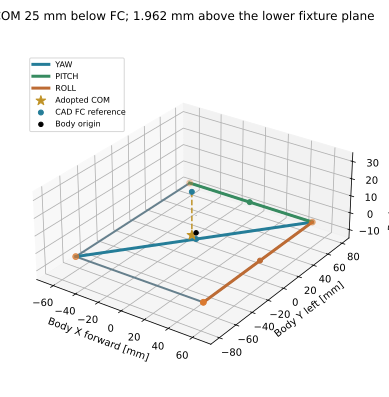
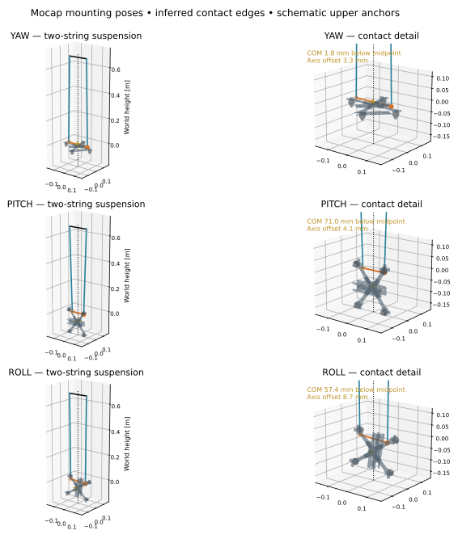
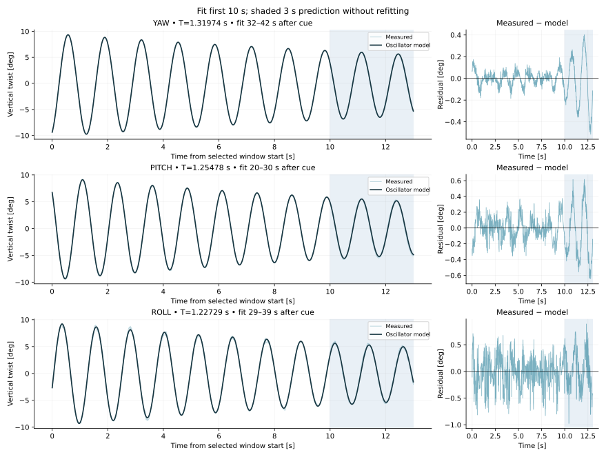

# Mass, centre of mass and inertia

[Adopted parameters](../parameters/inertial_model.json) · [Fixture geometry](../parameters/fixture_geometry.json) · [Original poses](../data/raw/bifilar/) · [Reproduce](reproduction.md)

The measured **total suspended mass is 716 g**. The operator adopted the approximate CAD FC reference **25 mm down along body Z** as the working COM. Body axes are **X forward, Y left, Z up**; the reference origin is the mean of the four motor-region markers M3–M6.

| Moment about adopted COM | kg·m² |
|---|---:|
| Roll $I_{xx}$ | **0.0020581804586** |
| Pitch $I_{yy}$ | **0.0017673633156** |
| Yaw $I_{zz}$ | **0.0031496362931** |

Products of inertia at COM are assumed zero. Three scalar tests cannot identify all six independent tensor entries. The 716 g includes the recorded attachments; no separate marker/fixture inertia has been subtracted. These values represent the weighed configuration under the adopted geometric assumptions.

## COM and contact locations

The frozen adopted COM is **[−3.000156, −1.000000, −1.688334] mm** relative to the body origin. The approximate CAD FC reference is at Z = 23.311666 mm. Lower contacts form a **110 mm body-X × 140 mm body-Y rectangle**, **10 mm below the arm undersides**, at Z = −3.650 mm. Thus the adopted COM is **1.961666 mm above the fixture plane**. This relative height cancels a common vertical CAD display translation, although it still depends on the FC/COM estimate.

Orange is the lower contact pair; blue lines are the two strings; the gold star is COM. The dotted world-vertical line through the contact midpoint defines the approximate torsional axis. The gold horizontal segment is the perpendicular offset used for the parallel-axis correction. All plotted world coordinates are metres. Upper anchors are schematic: horizontal and centred over the lower midpoint, with the reported string length treated as their mean.

| Mounting | Inferred lower pair | Midpoint in body [mm] | COM below midpoint | RMS perpendicular COM offset |
|---|---|---|---:|---:|
| Yaw | Opposite corners | [0, 0, −3.650] | 1.81 mm | 3.25 mm |
| Pitch | Left 110 mm edge | [0, 70, −3.650] | 70.97 mm | 4.11 mm |
| Roll | Front 140 mm edge | [55, 0, −3.650] | 57.39 mm | 8.71 mm |

The operator confirmed two strings and different pairs, but did not recall the side for roll/pitch. **Front roll / left pitch are inferred from the mocap pose and freely hanging stability**: opposite edges put COM above the contact line. Strings were not tracked; frame contact or another support would invalidate that inference. Either yaw diagonal shares the same midpoint. The 178.04 mm rectangle diagonal differs slightly from the reported 180 mm yaw lower spacing; the inertia calculation retains **180 mm**.

Changing roll front/rear and pitch left/right changes the diagonal estimates by about **1.1% roll and 0.6% pitch**, with negligible yaw change. These are geometric scenarios, not confidence bounds. The fixture midpoint correction supersedes the earlier common-origin estimate and reduces its roll value by about **2.4%**.

## Recorded motion and model

| Axis | Loaded length | Top / bottom spacing | Selected window after cue | Period | Body-axis tilt |
|---|---:|---:|---:|---:|---:|
| Yaw | 685 mm | 155 / 180 mm | 32–42 s | 1.319744 s | 2.75° |
| Pitch | 670 mm | 155 / 110 mm | 20–30 s | 1.254784 s | 2.71° |
| Roll | 680 mm | 155 / 140 mm | 29–39 s | 1.227286 s | 9.80° |

Each capture contains approximately 45 s after a 10 s countdown, sampled near 200 Hz. Time zero is the cue, not an independently recorded release. The local oscillator is

$$
\theta=c_0+c_1(t-\bar t)+e^{-\lambda t}[A\cos(2\pi f_dt)+B\sin(2\pi f_dt)].
$$

The solid curve fits the first 10 s shown, then predicts the shaded 3 s without refitting. These are temporal holdouts from the same capture, not independent-run predictions. The historical holdout RMS errors are about **0.243° yaw, 0.348° pitch and 0.342° roll**.

The selection audit favours the earliest passing 10 s interval in the latest qualifying run. It requires small initial amplitude, sufficient cycles, low rocking, continuous source timestamps and no pose jumps. Large-angle or discontinuous intervals are retained as context, rather than erased. Two independent yaw and two pitch recordings contain clean small-angle windows; their matched-window periods differ by 0.047% and 0.031%. Roll has one strict small-angle recording. Angular residual percentages are not inertia uncertainty.

## Pose-aware calculation

With half-spacings $a,b$, string length $L$, total mass $m$, and decay rate $\lambda$:

$$
h=\sqrt{L^2-(a-b)^2},\qquad k_\theta=mgab/h,\qquad
I_{axis}=\frac{k_\theta}{(2\pi f_d)^2+\lambda^2}.
$$

The recorded quaternion is $R_{WM}$ in XYZW order. The nominal operator-described marker-from-body rotation is $R_{MB}=\mathrm{diag}(1,-1,-1)$, so

$$
R_{WB}=R_{WM}R_{MB},\qquad n_B=R_{WB}^{T}e_z.
$$

For each lower contact midpoint $p_i$ and adopted COM $r_G$:

$$
I_{axis,i}=n_i^T I_G n_i+m\left(\|r_G-p_i\|^2-[n_i^T(r_G-p_i)]^2\right).
$$

Squared direction components and offsets are averaged over **all selected poses** before solving the three diagonal equations. The matrix condition number is approximately 1.04. Static mounting tilt is included; it is not removed by assuming every axis was level.

## Geometry and accuracy limits

CAD is a visual/registration reference, not a separately calibrated mass model. The Motive point table and streamed pose basis are kept distinct; no guessed extra axis swap is applied to recorded quaternions. M7 was corrected to 44.100 mm by the operator. Typed M2-Z (−3.984 mm) and M3-Y (−1.565 mm) differ from the live descriptor (−3.18375 and +1.56529 mm); typed points remain authoritative for the preview pending resolution.

Exact loaded lengths of both individual strings, upper-anchor positions, independent FC/COM survey, marker masses and measurement tolerances remain unavailable. Raven's physical marker diameter is unconfirmed; the displayed 12.7 mm size/clearance is illustrative. The adopted model is frozen separately so regenerating an image cannot change inertial parameters. No calibrated total uncertainty is claimed.
